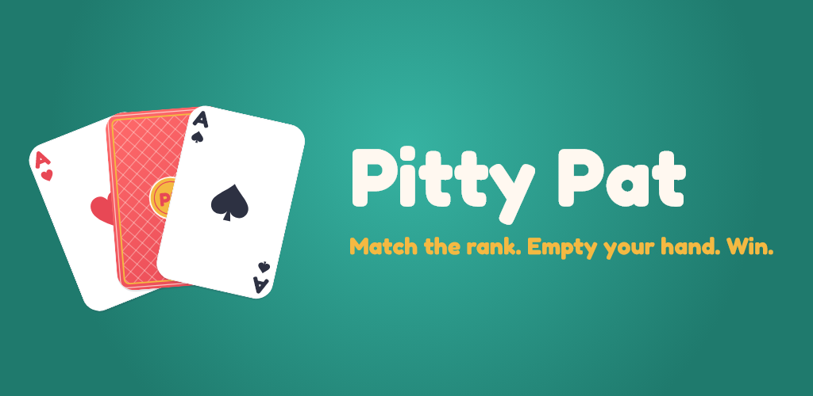
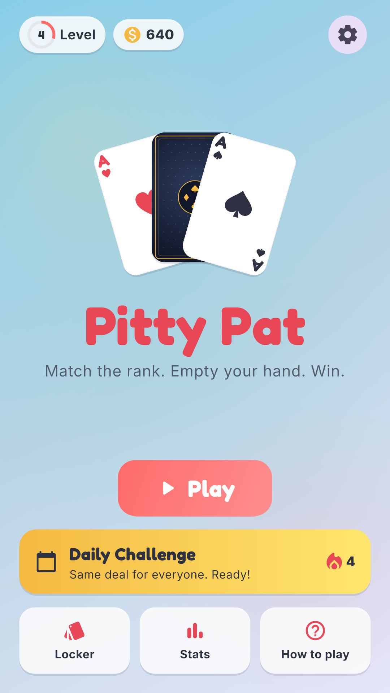
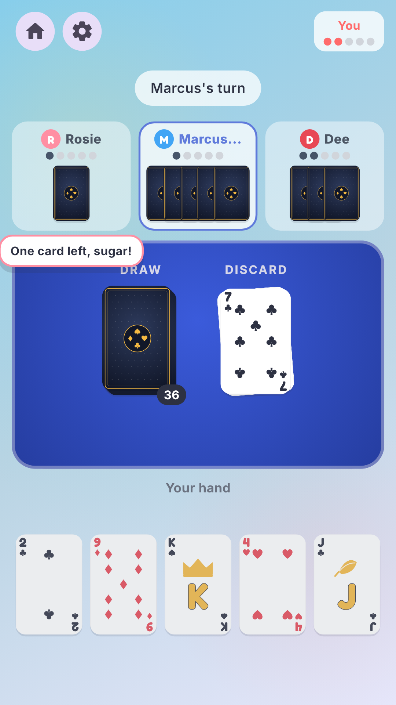
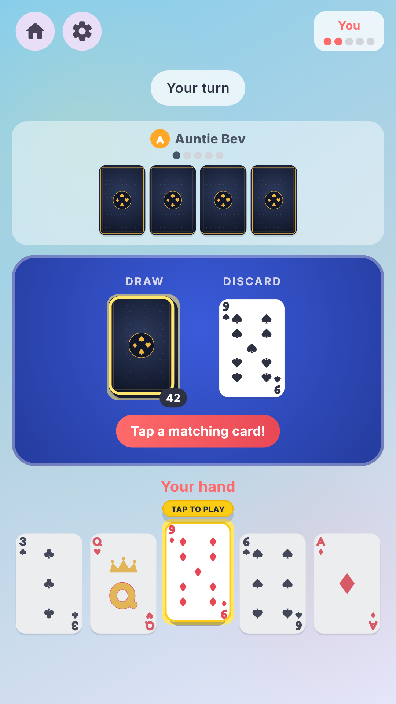
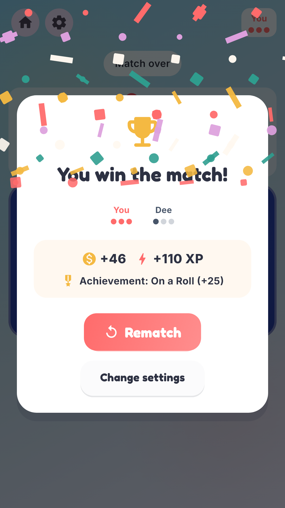
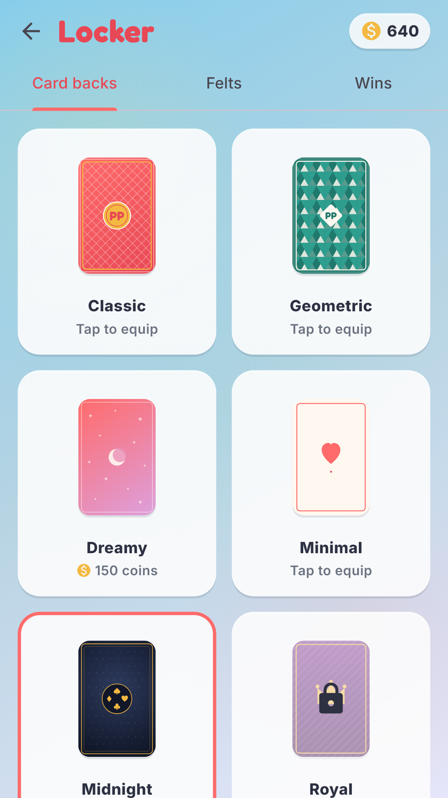

<p align="center">
  
</p>

<h1 align="center">Pitty Pat</h1>

<p align="center">
  <b>Match the rank. Empty your hand. Win.</b><br>
  The classic Southern card game, rebuilt for the browser and for Android.
</p>

<p align="center">
  
  
  
  
  <br>
  
  
  
  
</p>

<p align="center">
  
  
  
  
  
</p>

---

## The game in four moves

| | |
|:---:|---|
| **1** | Look at the top card on the discard pile. |
| **2** | Holding the same rank? Tap it, then tap again to play it. Suits don't matter. |
| **3** | No match? Tap the deck. If the drawn card matches, it plays itself. |
| **4** | First to empty their hand wins the round. First to 3, 5 or 10 rounds wins the match. |

> **House rules.** You may draw even when you hold a match. If a round can never finish (every rank still in a hand has no copy left in the deck or discard pile), the cards are redealt and nobody scores.

---

## Two ways to play

<table>
<tr>
<td width="50%" valign="top">

### On the web
Open it in any browser, no install and no account.

- One-on-one against the computer
- Chill, Clever or Sharp difficulty
- Matches to 3, 5 or 10
- Four card-back styles, confetti on a win
- SEO-friendly rules and how-to-play pages

</td>
<td width="50%" valign="top">

### On Android
A native Flutter app with everything the web has, plus:

- **Tables of 2 to 4 players**
- **Nine named opponents** with their own play styles and table talk
- **The Ladder**: beat everyone, one rung at a time
- **Daily Challenge**: the same deal for everyone, with streaks
- **Pass and Play** for 2 to 4 people on one phone
- Coins, XP, a cosmetics Locker, 15 achievements, head-to-head stats
- A first-run tutorial, sound, haptics and reduced-motion support

</td>
</tr>
</table>

---

## How the computer plays

Pitty Pat has one real decision: play a match or draw. Playing always wins on tempo, because drawing never shrinks your hand. So the computer never "outsmarts" you; difficulty is how often it **overlooks a match it is holding**.

| Level | Misses a playable card | In one line |
|---|:---:|---|
| **Chill** | 35% | Misses plays |
| **Clever** | 12% | Rarely slips |
| **Sharp** | never | Never misses |

---

## Meet the table *(Android)*

Each opponent stays close to their tier's miss rate, but *when* they slip and how fast they move is their own.

| | Opponent | Tier | Tagline | How they play |
|:---:|---|---|---|---|
| 1 | **Rosie** | Chill | Strong finisher | Never misses with two or fewer cards left |
| 2 | **Pops** | Chill | Takes it slow | The slowest hand at the table |
| 3 | **Lulu** | Chill | Sloppy if ahead | Quick, and careless while she leads |
| 4 | **Marcus** | Clever | Plays defense | Never misses while anyone is on their last card |
| 5 | **Auntie Bev** | Clever | Fights back | Never misses while she's behind |
| 6 | **Theo** | Clever | Tilts easily | Quick, and careless while he's behind |
| 7 | **Dee** | Sharp | Lightning fast | Never misses, and barely pauses |
| 8 | **Jada** | Sharp | Never misses | Never misses |
| 9 | **Vince** | Sharp | Patient pro | Never misses, and takes his time |

### The Ladder

Face all nine in that order, one-on-one, first to 3. Beat the next rung to unlock the one above it. The first clear of each rung pays a coin bonus, from **+25** for Rosie up to **+145** for Vince, and clearing each tier earns an achievement. Your record against every opponent is kept on the Stats screen.

---

## Quick start

**Web**

```bash
npm install
npm run dev          # http://localhost:3000
```

**Android** (from `mobile/`)

```bash
flutter pub get
flutter run -d <device>              # debug, with hot reload
flutter build apk --release          # a full-speed APK you can sideload
```

**Checks**

| | Web | Android |
|---|---|---|
| Tests | `npm run test` (Vitest) | `flutter test` |
| Lint | `npm run lint` | `flutter analyze` |
| Types | `npm run typecheck` | included in `flutter analyze` |
| Layout without a device | | `OUT_DIR=<dir> flutter test tool/render_screens.dart` |

---

## How it's built

```
app/ components/ hooks/ lib/ types/     Next.js web game
  lib/game-engine.ts                    the rules, as pure functions
  lib/ai-player.ts                      the computer opponent
  hooks/useGameState.ts                 reducer + turn sequencing

mobile/                                 Flutter app (Android first, iOS later)
  lib/game/                             1:1 Dart port of the engine, AI and reducer,
                                        plus play styles and personalities
  lib/profile/                          coins, XP, achievements, ladder, head-to-head
  lib/screens/  lib/game_ui/  lib/cards/    screens, motion and the painted card art
```

A few principles hold both sides together:

- **One set of rules.** The Dart engine is a line-for-line port of the TypeScript one. Any rule change lands in both, with tests on both sides.
- **State is the only truth.** Animations, sound and haptics read state changes; they never drive the game.
- **Testable randomness.** Shuffles and computer choices take an injectable random source, so deals, daily challenges and AI decisions are reproducible in tests.

For a file-by-file map see [CODE_MAP.md](CODE_MAP.md); for working conventions see [CLAUDE.md](CLAUDE.md).

---

## License

[ISC](LICENSE) © 2026 Nicholas Perry

<p align="center"><i>Match the rank. Empty your hand. Pat.</i></p>
